<div align="center">
  
  <h1>Lumine</h1>
  <p><strong>A local-first AI companion that lives on your desktop.</strong><br>
  Voice, memory and tools run on your own machine.</p>
</div>

<div align="center">
  <a href="LICENSE"></a>
  
  
  
  
</div>

---

Talk to it. It hears you, thinks, and answers out loud — and when a request needs
hands, it reaches for them: a browser it drives, a program it opens, a message it
drafts for your approval. When a request has more than one step, it plans the
steps, checks each one actually happened, and tells you what is still uncertain.

Everything runs on your own machine. The desktop app is a Tauri shell over a
persistent Python LiveKit worker. There is no cloud backend of Lumine's own, and
no API key ever reaches the webview.

This is a working voice session with a real presentation around it — not a
packaged product. See [Project Status](#project-status) before you install
anything.

## Contents

- [What Lumine Is](#what-lumine-is)
- [The North Star](#the-north-star)
- [What She Can Do](#what-she-can-do)
- [Screenshots](#screenshots)
- [Features](#features)
- [Architecture](#architecture)
- [The Agent Runtime](#the-agent-runtime)
- [The Tool Registry](#the-tool-registry)
- [Getting Started](#getting-started)
- [Configuration](#configuration)
- [Testing](#testing)
- [Documentation](#documentation)
- [Project Status](#project-status)
- [Known Issues](#known-issues)
- [Contributing](#contributing)
- [License](#license)
- [Author](#author)

## What Lumine Is

Lumine is three processes and one conversation.

A **Tauri** desktop shell in **Rust** owns the window, the OS keyring and the
lifecycle of a **Python** worker. That worker is a persistent LiveKit
`AgentServer`; each conversation is a fresh room with its own `AgentSession`
built from the profile you configured. Between them sits the **runtime** — the
layer that decides whether a request needs one step or five, plans it, checks
permission, executes it, reads the screen afterwards, and reports what is true
rather than what went well. The **React** webview never talks to LiveKit's
secrets — it asks Rust for a token and consumes high-level state events, so the
UI holds no provider knowledge at all.

The default voice path is a single native-audio **Gemini Live** realtime model
that hears, thinks and speaks in one turn. A Groq + Silero + Cartesia cascade is
preserved and still selectable.

## The North Star

> **Lumine should feel like a companion living quietly on the computer, not an
> application the user has to open.**
>
> She should sleep when not needed, hear when called, appear when addressed,
> understand the complete request, act when authorized, communicate naturally, and
> disappear again when the interaction is over. **The full UI is her home, not her
> existence.**

The intended experience is closer to **Jarvis / Siri / Alexa, plus an anime-style
desktop companion, plus an autonomous computer-use agent** than to **ChatGPT in a
desktop window**:

- **Always available, not always visible.** A resident runtime starts with Windows
  and stays hidden. The full UI opens only when asked for.
- **One-shot commands.** "Hey Lumine, what's the weather?" is one interaction, not
  three turns.
- **A transient island**, not a window. A small top-centre surface appears on wake
  and retracts when the conversation is over.
- **IDLE is not SLEEPING.** A follow-up sentence needs no wake phrase; an idle
  session eventually closes and leaves only the wake listener running.
- **Wake is local.** Nothing streams microphone audio to a provider to decide
  whether you said her name.

How far the code is from that, honestly and in detail, is in
[`docs/gap-audit.md`](docs/gap-audit.md). The target design is in
[`ARCHITECTURE.md`](ARCHITECTURE.md), the companion phases in
[`ROADMAP.md`](ROADMAP.md), and the internal runtime phases in
[`docs/agent-runtime/`](docs/agent-runtime/README.md).

## What She Can Do

### Today

| You say | What happens |
|---|---|
| "What's the weather in Dhaka?" | One lookup, one answer. No task, no ceremony |
| "Open Notepad." | Resolves the name to one target, launches it, **waits for the window**, reports it opened |
| "Open Chrome, search YouTube for *X*, play it, then start a 25-minute timer." | A **task**: routed, planned, executed step by step, each step observed afterwards, the whole thing cancelable |
| "Send this WhatsApp message to Afia." | Resolves the contact, opens the chat, **types the text and reads it back out of the composer**, asks, sends, then confirms delivery from the message bubble |
| "Has anyone replied in the Afia chat?" | Reads the chat — and asks once, out loud, because that grant lasts the rest of the conversation |
| "Play my vocal songs." | Matches the words you *said* against a real library, then opens **one ordered queue** rather than nine simultaneous launches |
| "Click the save button." | Looks at the screen first, acts on a control it actually found, and re-reads before anything irreversible |
| "Delete this file." | **Refused** — she has no verb that deletes a file. This is a decision, not a gap |

### And the habits that matter more than the verbs

- **She never reports success she did not observe.** Every side-effecting action
  reports one of seven honest states, and *"Windows took the input but I did not
  read the application afterwards"* is a sentence she can actually say.
- **An approval is one action, once.** It is spoken *and* shown as a card carrying
  the same sentence, expires in 60 seconds, and a bare "yes" answers it. Silence is
  a refusal, not a maybe.
- **A tool result is small on purpose.** It is compressed, structured, and capped,
  because it is re-sent on every later turn in the conversation.
- **Retrieved text is data, never instruction.** A web page or a message that says
  "ignore previous instructions" is wrapped so it cannot become a command.

### On the way

Each row names the phase that delivers it.

| Situation | Track |
|---|---|
| "Hey Lumine, what's the weather?" — one interaction, no window ever opens | companion Phase 1 |
| A task survives the worker restarting underneath it | runtime Phase 3 |
| A browser failure re-observes and recovers instead of claiming it worked | runtime Phase 4 |
| "Read the notes file I keep in Documents." | runtime Phase 6 |
| "Continue where we left off." — task and preference context, loaded selectively | runtime Phase 7 |
| "Find something on my PC I half-remember." | runtime Phase 8 |
| "Research this and tell me when you're done." | runtime Phase 9 |
| She says something first, when it is worth saying | companion Phase 9 |

Full goals and the definition of done:
[`docs/agent-runtime/README.md`](docs/agent-runtime/README.md).

## Screenshots

Every shot below is the running app, in the two palettes this project ships
with its own design: a sage-green light theme and its dark counterpart.

### The companion

<table>
<tr>
<td width="50%">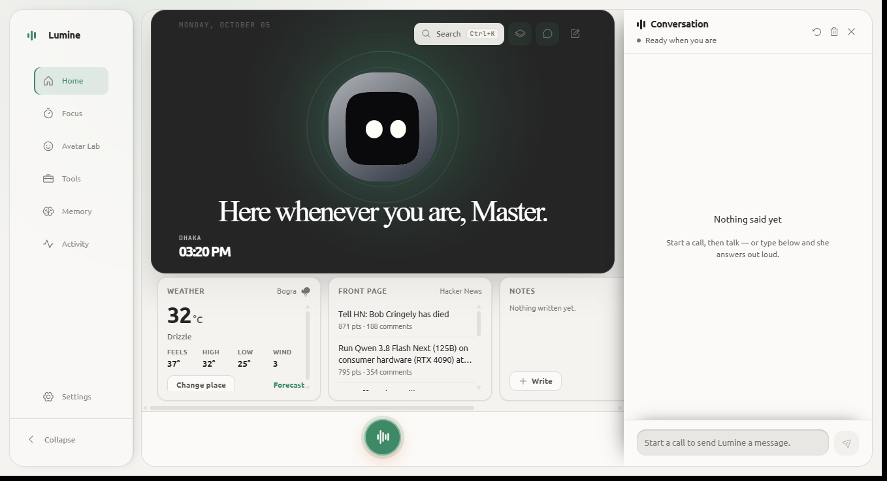</td>
<td width="50%">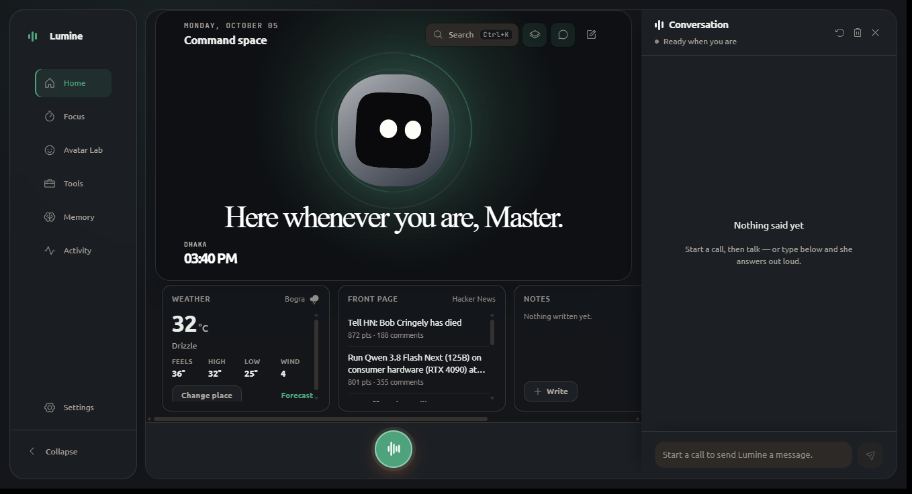</td>
</tr>
<tr>
<td><sub>Presence, call bar, weather, news, notes, transcript</sub></td>
<td><sub>The same room in dark</sub></td>
</tr>
</table>

### What she can reach

<table>
<tr>
<td width="50%">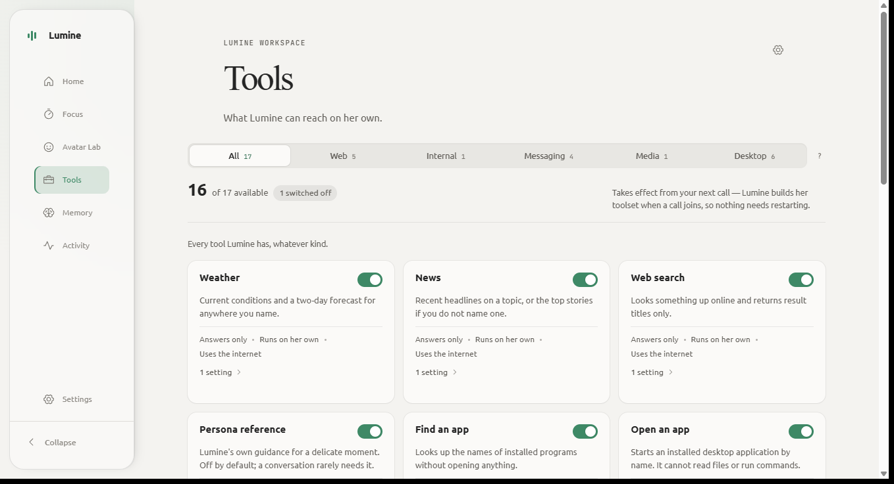</td>
<td width="50%">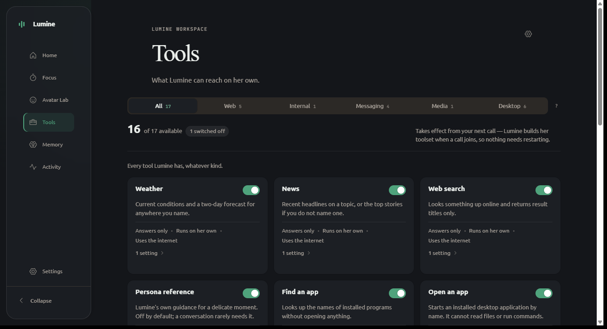</td>
</tr>
<tr>
<td><sub>All 17 tools, five categories, one switch each</sub></td>
<td><sub>16 of 17 available — desktop control ships off</sub></td>
</tr>
</table>

### What the worker reported

<table>
<tr>
<td width="50%">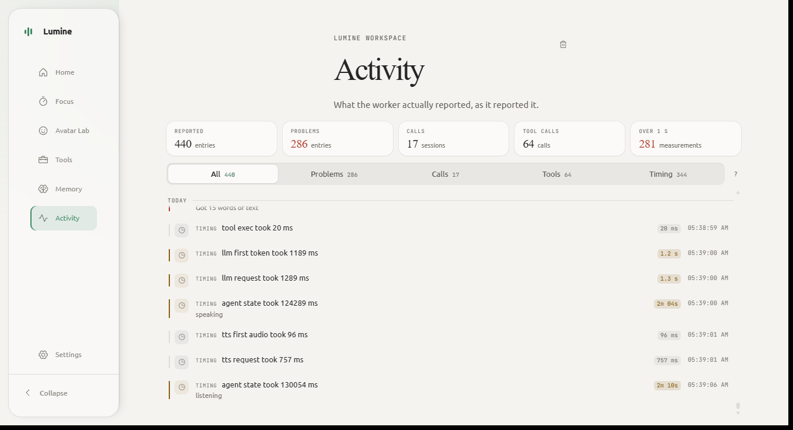</td>
<td width="50%">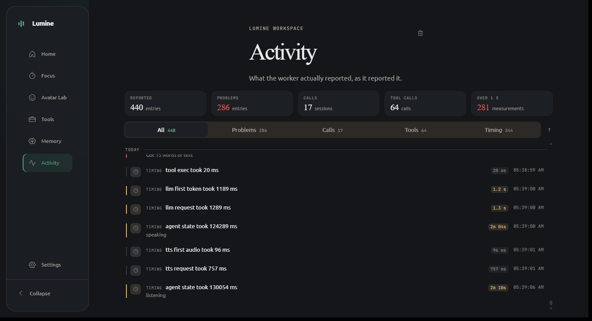</td>
</tr>
<tr>
<td><sub>Latency, problems and tool calls, persisted across restarts</sub></td>
<td><sub>Filterable by kind, counted per session</sub></td>
</tr>
</table>

### The face

<table>
<tr>
<td width="50%">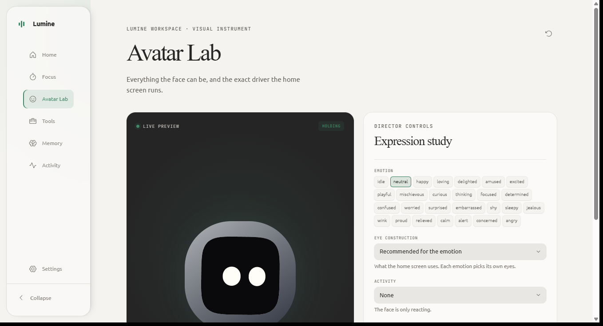</td>
<td width="50%">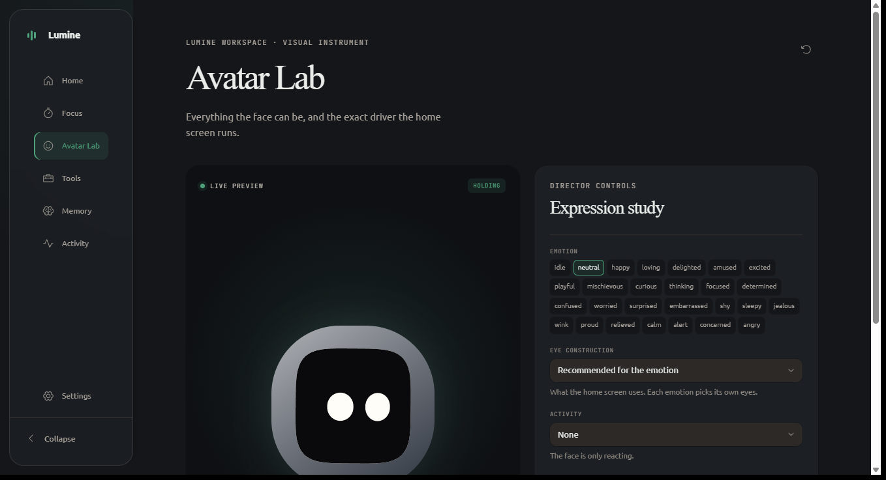</td>
</tr>
<tr>
<td><sub>27 emotions, eye construction, activity — driven by the same engine the home screen runs</sub></td>
<td><sub>&nbsp;</sub></td>
</tr>
</table>

### The AI Control Center

<table>
<tr>
<td width="50%">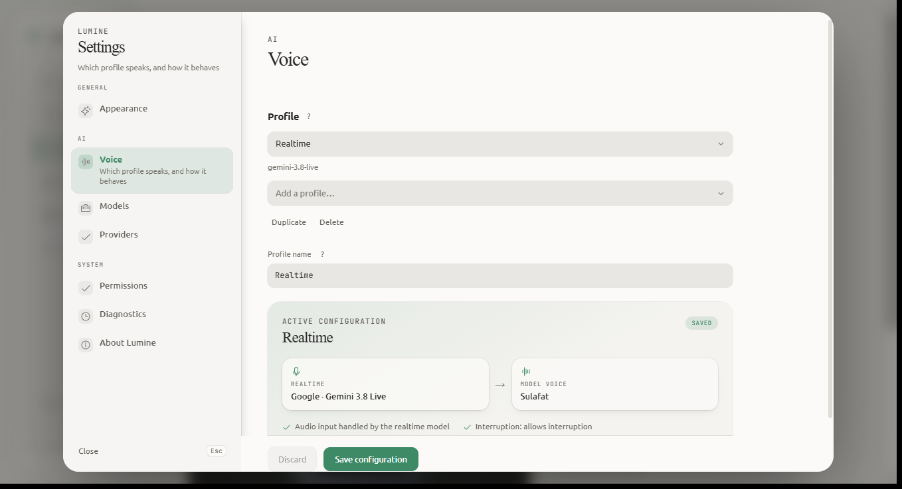</td>
<td width="50%">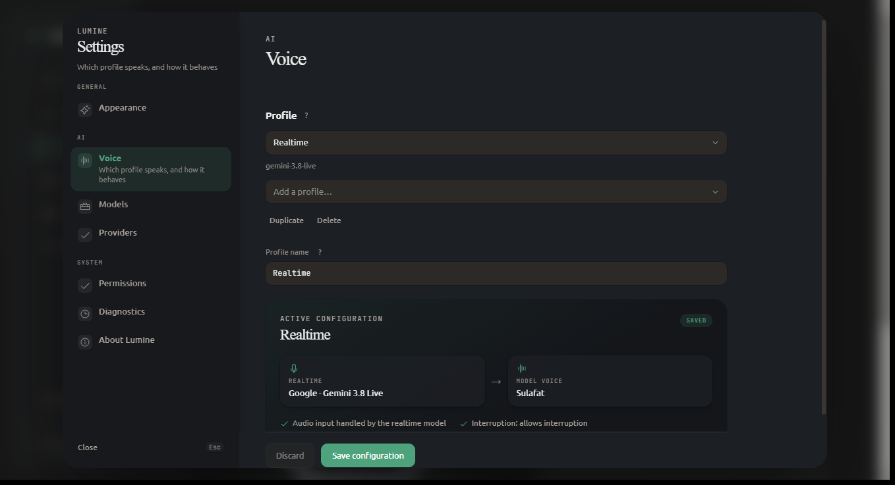</td>
</tr>
<tr>
<td><sub>Which profile speaks, and the stack it resolves to</sub></td>
<td><sub>&nbsp;</sub></td>
</tr>
</table>

<table>
<tr>
<td width="33%">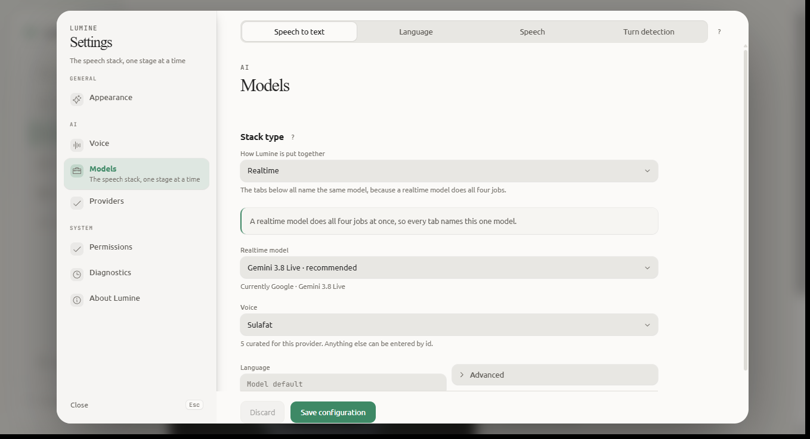</td>
<td width="33%">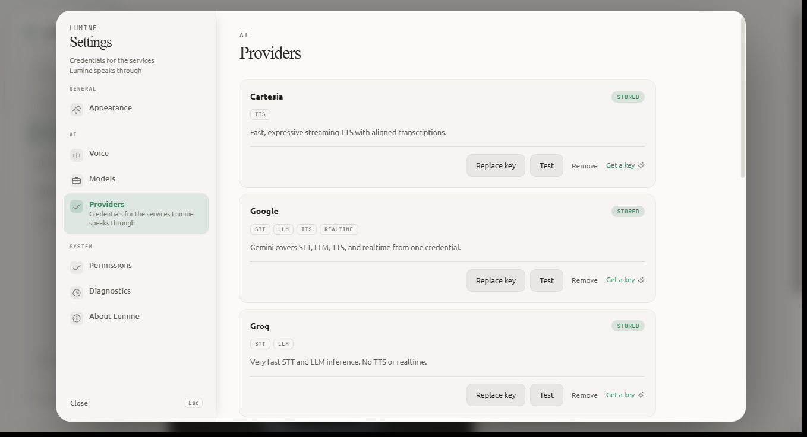</td>
<td width="33%">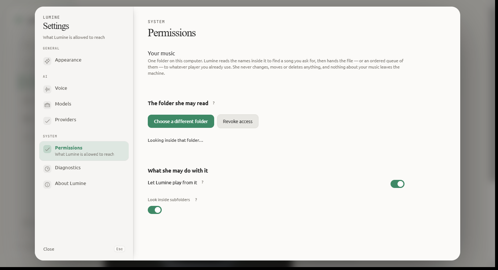</td>
</tr>
<tr>
<td><sub>Stages and models</sub></td>
<td><sub>Credential slots in the OS keyring</sub></td>
<td><sub>The one folder she may read</sub></td>
</tr>
</table>

## Features

**Voice and presence**
- One persistent worker, one fresh session per conversation — the worker outlives the call.
- Native-audio realtime by default; the legacy VAD/STT/LLM/TTS cascade is still selectable.
- Camera and screen input for models that declare those modalities, and a refusal with the real reason when the platform cannot.
- An SVG avatar with a canonical 27-emotion vocabulary plus an `idle` state, an activity layer, cursor gaze, and barge-in.

**A runtime, not a tool bag**
- A **task** for anything with two or more dependent steps: routed to the right environment, planned, executed step by step, and cancelled as a whole.
- **Seven honest outcome states** for every side-effecting action, from *"we decided to"* to *"we read it afterwards and it changed."* Nothing implies success.
- **Dependencies gate rather than order**, so a step runs when its prerequisites are real, and a blocked step is *skipped* rather than *failed* — "we never tried" is a different fact from "we tried and it did not work."
- **Uncertain is a decision, not an accident.** When an outcome is genuinely unknown, a retry becomes something Lumine asks about rather than something she does.
- No retry loop, deliberately: a session that keeps trying a rate limit spends the quota it has left.

**Seventeen tools, five categories**
- *Web* — weather, news, search, plus two page drivers: one addressed by reference, one by what controls are called.
- *Internal* — her own guidance, read on demand rather than preloaded into every turn.
- *Media* — one folder you choose; a subfolder is a playlist.
- *Messaging* — WhatsApp: chats, unread, messages, search, contact details, chat management, account verbs, and sending.
- *Desktop* — find and open programs, arrange windows, drive the mouse and keyboard, and run a multi-step request end to end.

**Desktop control**
- Mouse and keyboard for any application without a dedicated tool, through Windows UI Automation. Ships **off**; the Tools page card is the switch.
- It refuses exactly two things: Lumine's own window, and password fields. Everything else runs.
- "The screen" is never assumed to be the foreground window — while you are talking to her, the foreground window *is Lumine*.

**Messaging that asks first**
- A send types the text into the chat and reads it back out of the composer *before* the approval question, so what you approve is on your own screen.
- Reading someone's messages is a separate tool that asks once per conversation and says out loud that the grant lasts the rest of it.
- An uncertain send is never retried. A duplicate in someone's name is worse than a missing message.

**Boundaries rather than warnings**
- A model-supplied path is resolved first and compared second, so `..`, an absolute path and a symlink out all land in the same refusal.
- The music folder is a boundary: no verb moves, renames or deletes anything.
- Every side-effecting action passes one gate that speaks the question, shows a card carrying the same sentence, and appends a SHA-256-digested record to a local audit log.

## Architecture

```text
React 19 + Vite  (webview)
  │   Tauri commands + events — no LiveKit secret ever crosses this line
  ▼
Rust  (src-tauri)   agent_manager ─ credentials ─ settings_store ─ media
  │   spawns the worker, injects keyring values one variable per slot,
  │   re-emits its LUMINE_EVENT stdout stream as Tauri events
  ▼
Python  (agent/)   persistent AgentServer "lumine" ─ one AgentSession per room
  │
  ├── runtime/      router · task_model · task_engine · verification · permission_gate
  └── tools/        17 gated tools across five categories
```

| | Tauri shell | Python worker |
|---|---|---|
| Language | Rust | Python 3.10+ |
| Owns | window, keyring, worker lifecycle, settings document | the voice session, the runtime, the tools, the browser |
| Lifetime | as long as the app | outlives the app's conversations |
| Talks to | the OS, the webview, the worker | LiveKit, providers, the user's machine |
| Knows nothing about | Groq, Cartesia, VAD | React, the window, the theme |

The worker is **persistent**, not per-session: one process, one registration,
many rooms. That is why a profile change takes effect on the next call without a
restart, and why "the worker is running" is not the same statement as "Lumine is
listening" — the UI reports those separately.

**Stack:** Tauri 2 · React 19 · TypeScript 5.8 · Vite 7 · Tailwind CSS 4 ·
Rust 2021 · Python 3.10–3.14 · LiveKit Agents 1.8 (Google, Groq, OpenAI, Silero,
Cartesia plugins) · Playwright · UI Automation.

That is the architecture **today**. The companion runtime the vision describes —
a resident process, a local wake listener, and a transient island in front of this
UI — is designed in [`ARCHITECTURE.md`](ARCHITECTURE.md) and built in the phases
of [`ROADMAP.md`](ROADMAP.md). This diagram will keep working when it lands: the
worker's process separation, the keyring boundary and the event stream are all
load-bearing under the target design, not scaffolding to be replaced.

## The Agent Runtime

The layer between "she understood the request" and "here is what actually
happened." It is invisible to the user, which is the point.

```text
request ──▶ router ──▶ plan ──▶ permission ──▶ execute ──▶ observe ──▶ verify
             pure      validated   one gate     one step     read it    report
             routing   no cycles    per verb     at a time    again      honestly
```

| Module | Owns |
|---|---|
| `runtime/router.py` | Which environment a request belongs in — pure, over a request plus facts about the machine |
| `runtime/task_model.py` | `Task` and `Step`: dependencies, retry policy, cancellation |
| `runtime/task_engine.py` | Deterministic progression, checkpoints, bounded concurrency |
| `runtime/verification.py` | The seven-value vocabulary every side effect reports in |
| `runtime/permission_gate.py` | One gate for all 17 tools: voice and UI consent, expiry, audit |
| `runtime/progress.py` | A tool narrating its own steps, so silence is brief |
| `runtime/failure_gate.py` | Three consecutive failures opens a circuit and she apologises once |
| `tools/task_runner.py` | The `run_task` / `cancel_task` tool, where the three meet |

Three properties that took measurement to arrive at, and that the code is written
around:

- **The planner is a deterministic scenario table, not a model call.** A model
  asked to "keep calling tools until this is done" re-plans after every call, and
  every re-plan is a chance to change its mind mid-sequence — which is how a
  browser opens twice.
- **Freshness is a second reading, never a token.** "Click 7" only means something
  relative to a picture of the screen. A reference is refused when the screen has
  moved on.
- **A broken selector degrades to a refusal**, never to a plausible wrong action.
  "I couldn't find the send button" is a useful answer; a send that went to
  somebody else is not.

[`docs/agent-runtime/`](docs/agent-runtime/README.md) carries the goals, the
phases, and the definition of done for finishing this layer properly.

## The Tool Registry

`agent/tools/tools_registry.py` is the source of truth, and `agent/tool_catalog.py`
prints the live list. Every tool has an action class — `read`, `act`, `sensitive`
or `destructive` — that the saved config can only raise, never lower.

| Tool | Category | What it does | Gate |
| --- | --- | --- | --- |
| `get_weather` | Web | Current conditions and a two-day forecast | auto |
| `get_news` | Web | Recent headlines on a topic, or the top stories | auto |
| `search_web` | Web | Looks something up; returns result titles only | auto |
| `browse` | Web | Drives a page by reference — open, observe, act, back, forward, scroll, tab, close | ask |
| `web_control` | Web | Drives a page by what its controls are called | ask |
| `recall_persona` | Internal | Her own guidance for a delicate moment | auto |
| `play_media` | Media | Finds and plays from the one folder you chose | auto |
| `whatsapp_read` | Messaging | Chats, unread, a chat's messages, message search, a contact | ask |
| `whatsapp_chats` | Messaging | Mark read, pin, mute, archive, star, delete, block | ask |
| `whatsapp_account` | Messaging | Presence, linked devices, about, unlink, call | ask |
| `send_whatsapp` | Messaging | Sends, only after you approve the exact text | ask |
| `find_app` | Desktop | Names of installed programs. Opens nothing | auto |
| `open_app` | Desktop | Starts an installed application by name | auto |
| `manage_window` | Desktop | Lists, focuses, resizes and closes windows | ask |
| `desktop_control` | Desktop | Mouse and keyboard in any application — **ships off** | ask |
| `run_task` | Desktop | A multi-step request end to end, checking each step worked | ask |
| `cancel_task` | Desktop | Stops the current task, including steps not yet started | auto |

**The function tools stay as they are.** The approved direction is a canonical
dotted capability namespace — `computer.click`, `browser.page.open`,
`communication.send_message` — as the *authority* for policy keys and the Tools
page, while these verb-parameterised tools stay the efficient *interface* the
model is shown. The measured reason is in
[ADR-0014](docs/decisions/0014-canonical-capability-namespace.md): the tool
schemas already cost ~4.7k tokens on every completion, and Gemini Live offers no
`parallel_tool_calls` backstop.

## Getting Started

### Prerequisites

| | |
| --- | --- |
| **OS** | Windows (verified). The code avoids Windows-only assumptions, but no other platform has been exercised. |
| **Python** | 3.10 – 3.14. This is `livekit-agents` 1.8.3's own supported range, not a preference. |
| **Node** | `20.19+` or `22.12+`, which is what Vite 7 asks for. |
| **Rust** | Stable toolchain. On Windows, Visual Studio Build Tools with the C++ workload. |
| **Accounts** | A LiveKit project (cloud or self-hosted) and a Google AI Studio API key. |

### 1. Clone and set up Python

```powershell
git clone https://github.com/Atrbd-Playz/Lumine-AI_Assistant.git
cd Lumine-AI_Assistant

python -m venv .venv
.\.venv\Scripts\python.exe -m pip install -r agent\requirements.txt
```

### 2. Install the browser engine

`playwright` ships a driver, not a browser. The tools report this sentence rather
than failing to start:

```powershell
.\.venv\Scripts\python.exe -m playwright install chromium
```

### 3. Add four credentials

The default pipeline is `gemini_live`, so a working install needs exactly four
values from two providers:

| Variable | Where |
| --- | --- |
| `LIVEKIT_URL` | <https://cloud.livekit.io/> — `wss://…` for cloud |
| `LIVEKIT_API_KEY` | Settings → API Keys, same project |
| `LIVEKIT_API_SECRET` | Settings → API Keys, same project |
| `GOOGLE_API_KEY` | <https://aistudio.google.com/apikey> |

**Prefer the app.** Settings → AI → Providers writes each one into the OS
keyring — Windows Credential Manager, macOS Keychain, Linux Secret Service — and
the Rust layer injects them into the worker process one variable per slot. That
path never writes a secret to disk in this repository.

To use files instead, copy the examples and fill them in:

```powershell
Copy-Item agent\.env.example agent\.env
Copy-Item lumine-ui\.env.example lumine-ui\.env
```

`agent/.env.example` ships with **every credential line empty**, and that is
deliberate rather than tidiness. Every credential check in the product treats "the
variable holds a non-empty string" as "you have this key", because telling a
placeholder from a real key would cost a billable request. A shipped `your-…`
placeholder therefore reads as a working credential: the setup gate says you are
ready and the first turn is a `401`. An empty value is a real absence, and it
leaves the line there to paste into.

### 4. Run it

```powershell
Push-Location lumine-ui
npm ci
npm run tauri dev
Pop-Location
```

That is the whole loop. The app starts the Python worker itself, waits until it
registers with LiveKit, and injects the keyring credentials — so voice does not
depend on a process you remembered to start.

### If something looks wrong

```powershell
# Which config file the worker is actually reading, and what it searched
.\.venv\Scripts\python.exe agent\validate_config.py --describe
```

- **Vite is on port 15173, strictly.** That is neither the Tauri-conventional
  `1420` nor Vite's own `5173`: Hyper-V and WSL redraw 100-port exclusion blocks
  inside the Windows dynamic port range on every boot (`1420` fell to
  `1351–1450`, `5173` to `5156–5255`), and binding an excluded port fails with
  `EACCES` rather than `EADDRINUSE`. Do not start a second Vite server there.
- **Stop any standalone worker before testing settings changes.** LiveKit
  dispatches a room to exactly one agent, so a worker left registered as `lumine`
  absorbs the next dispatch — which looks precisely like a broken worker. For
  debugging the worker on its own, run
  `.\.venv\Scripts\python.exe agent\agent.py dev` in a second terminal.

## Configuration

Precedence is **saved `lumine.config.json` → `agent/.env` → catalog defaults**,
resolved per key. The desktop app writes the document; a worker started outside
Tauri still finds it.

The settings that change what Lumine can do:

| Key | Default | What it decides |
| --- | --- | --- |
| `tools.<id>` | `on` | One switch per tool, written by the Tools page |
| `desktop.input` | `off` | Whether she may move the mouse and press keys |
| `messaging.whatsapp.mode` | `deeplink` | `off`, `deeplink` (you press send), or `automation` |
| `messaging.whatsapp.history` | `ask` | `off`, `ask` (once per conversation), or `auto` |
| `media.enabled` | `on` | The music library capability |
| `media.library` | — | The one folder she may read |
| `desktop.browsers` | asks | Whether "open a website" means your browser or hers |
| `capabilities.<dotted>` | — | *Runtime Phase 1.* Canonical capability overrides, resolving before the legacy keys |

Two of those fail in **opposite** directions on purpose. `tools.<id>` only ever
reduces authority, so an unrecognised value reads as `on`. `desktop.input` and
`media.enabled` *grant* a capability, so an unrecognised value there reads as
`off` and is reported as an error rather than a warning — falling through on a
misspelling there would mean `LUMINE_ENABLE_MEDIA=enabled` turned it on, the exact
inverse of what was meant.

`agent/settings/providers.py` is the executable authority and
`agent/settings/validation.py` is the schema. `LUMINE_PIPELINE=legacy_cascade` in
`agent/.env` switches to the Groq/Cartesia stack if you would rather not use
Gemini.

## Testing

```powershell
# Python — 66 test modules, 2232 tests
.\.venv\Scripts\python.exe -m unittest discover -s agent\tests -p "test_*.py"

# A single test
.\.venv\Scripts\python.exe -m unittest agent.tests.test_emotion_contract.EmotionContractTests.test_normalize_emotion_keeps_canonical_values

# Frontend typecheck and build
Push-Location lumine-ui; npm run build; Pop-Location

# Frontend contract checks — twelve of them
Push-Location lumine-ui; npm run check; Pop-Location

# Rust
Push-Location lumine-ui\src-tauri; cargo check; Pop-Location
```

The Python suite exercises parsing, permissions and formatting locally. It does
not depend on live providers, so it is safe to run offline.

Live probes, for when you need to look at the real thing:

| Command | What it tells you |
| --- | --- |
| `python agent\desktop_probe.py` | What the current window exposes. Read-only |
| `python agent\desktop_smoke.py` | End-to-end checks, staged so nothing moves until asked |
| `python agent\whatsapp_probe.py` | Which WhatsApp selectors are live in the current build |
| `python agent\tool_catalog.py --check` | Fails on a registered tool with no card |
| `python agent\provider_probe.py` | One cheap authenticated request per provider |
| `python agent\validate_config.py --describe` | Which config file won, and what was searched |

## Documentation

### The product

| Document | What is in it |
| --- | --- |
| [`VISION.md`](VISION.md) | The product vision and the North Star — what Lumine is, what she is not, and the success criteria |
| [`ARCHITECTURE.md`](ARCHITECTURE.md) | The target runtime: nine layers, process model, lifecycle state machine, IPC, wake, island |
| [`ROADMAP.md`](ROADMAP.md) | **Companion** phases 0–9 with observable exit criteria, and what each phase deliberately does not build |
| [`docs/decisions/`](docs/decisions/) | Fourteen decision records — the choices, the alternatives refused, and what would reverse them |

### The runtime

| Document | What is in it |
| --- | --- |
| [`docs/agent-runtime/`](docs/agent-runtime/README.md) | **Runtime** track: goals, phases 0–10, and the definition of done |
| [`docs/agent-runtime/00-architecture-audit.md`](docs/agent-runtime/00-architecture-audit.md) | What already exists, what is genuinely missing, and the three class-resolution models |
| [`docs/agent-runtime/01-capability-registry.md`](docs/agent-runtime/01-capability-registry.md) | **Phase 1, approved and ready to build** |
| [`docs/decisions/0014`](docs/decisions/0014-canonical-capability-namespace.md) | Why dotted capability ids do not split the model-facing tools |

### Reference

| Document | What is in it |
| --- | --- |
| [`docs/gap-audit.md`](docs/gap-audit.md) | The vision measured against the current code: gaps, conflicts, risks, open questions |
| [`docs/plans/wave-1-always-on-runtime.md`](docs/plans/wave-1-always-on-runtime.md) | The detailed companion Phase 1 plan |
| [`docs/ai-control-center.md`](docs/ai-control-center.md) | The AI Control Center decision record — credential slots, the catalog, why they are shaped that way |
| [`docs/voice-architecture.md`](docs/voice-architecture.md) | The process model and the full session lifecycle |
| [`docs/livekit-integration.md`](docs/livekit-integration.md) | LiveKit specifics and the pieces that surprised us |
| [`docs/desktop-control-testing.md`](docs/desktop-control-testing.md) | How to test desktop control, and how to read a failure rather than only that one happened |
| [`AGENTS.md`](AGENTS.md) | Repository instructions and the load-bearing invariants |
| [`agent/AGENTS.md`](agent/AGENTS.md) · [`lumine-ui/AGENTS.md`](lumine-ui/AGENTS.md) | Area-specific background for each half |

## Project Status

**Alpha, and honest about it.**

### Built and working

- [x] Persistent LiveKit worker with a per-room session, and a readiness gate that blocks until it registers
- [x] **A real agent runtime**: pure routing, a validated task model, a deterministic executor, and a seven-value verification ladder
- [x] **One permission gate** for every tool — voice and UI consent, 60-second expiry, session binding, SHA-256-digested audit
- [x] Seventeen gated tools across five categories
- [x] Two page drivers with real tab support, WhatsApp read / manage / send, desktop control through UI Automation, and a music library that queues a folder as one ordered list
- [x] observe → act → observe → verify enforced on desktop, with a stale reference refused rather than followed
- [x] AI Control Center: provider catalog, per-variable keyring slots, live probes, fail-closed setup gate
- [x] An activity feed that survives a reload, and an appearance system with importable palettes
- [x] 66 Python test modules (2232 tests) and twelve frontend contract checks

### Planned and documented

- [x] [`docs/agent-runtime/`](docs/agent-runtime/README.md) — the runtime track's goals and all eleven phases
- [x] Phase 0 architecture audit, complete
- [x] **Phase 1 approved and ready to build** — the canonical capability registry
- [ ] Phases 2–10 of the runtime track, and phases 1–9 of the companion track

### Not built

- [ ] **There is no installer.** `bundle.active` is `false`, so `npm run tauri build`
      writes `src-tauri/target/release/lumine.exe` and stops there.
- [ ] **The worker is not packaged as a sidecar.** A working install needs Python
      on the machine. That is the single biggest thing between this and a
      download.
- [ ] **No resident runtime, no tray, no minimize-to-tray, no autostart.** The app is
      only correct while its window is open: `ExitRequested` stops the worker, and
      nothing but a button press starts it.
- [ ] **No wake word and no island.** No local microphone path outside a LiveKit
      session, so nothing can hear her name while she is "asleep". No second window,
      and the frontend imports no Tauri window API at all.
- [ ] **No lifecycle state machine.** Three state vocabularies exist and none is
      authoritative; `AgentState::Sleeping` means "no worker process", which is the
      opposite of what the vision means by it.
- [ ] **No idle timeout**, so a session ends only when the last participant leaves.
- [ ] **No crash recovery or auto-restart.**
- [ ] **Tasks do not survive a restart.** `Task` is in memory; a worker restart loses
      an in-flight task silently. [Runtime Phase 3](docs/agent-runtime/03-persistent-task-store.md)
- [ ] **No persistent memory or project context**, and by decision the GSD-style
      `.lumine/projects/` layout was **rejected** — those describe a repo, not a
      person's work. [Runtime Phase 7](docs/agent-runtime/05-capabilities-and-context.md#phase-7--selective-context-retrieval)
- [ ] **No filesystem tools at all.** Read-only comes in
      [runtime Phase 6](docs/agent-runtime/05-capabilities-and-context.md#phase-6--read-only-filesystem);
      write and delete are not planned.
- [ ] **Windows only in practice.** Cross-platform by intent, unverified anywhere else.
- [ ] **No video output.** Lumine does not send frames back; the SVG avatar is the answer for now.

Every one of those is a numbered phase in [`ROADMAP.md`](ROADMAP.md) or
[`docs/agent-runtime/`](docs/agent-runtime/README.md), and the measurement behind
each is in [`docs/gap-audit.md`](docs/gap-audit.md).

There is no CI workflow yet, which is why the badges above say nothing about
build status. Run the checks locally before opening a pull request.

## Known Issues

Bugs found and named, so nobody rediscovers them as a mystery:

| Issue | Where | Notes |
|---|---|---|
| `play_media`'s tool card advertises **four** verbs while the tool implements **seven** (`search`, `next`, `previous` are missing from the card) | `agent/tools/tools_registry.py` `TOOL_CARDS` | The model reads the docstring, not the card, so this is a UI and settings-screen defect rather than a functional one. It is exactly the class of drift the Phase 1 registry exists to prevent. **Not yet fixed.** |
| `AgentState::Sleeping` means "no worker process" | `agent_manager.rs` | The opposite of the vision's meaning. [ADR-0012](docs/decisions/0012-process-vs-companion-state.md) |
| The session greeting is unconditional | `agent.py` | Fights the one-shot requirement. [ADR-0013](docs/decisions/0013-greeting-conditional.md) |

## Contributing

Run the Python suite, `npm run check` and `cargo check` first. There is no CI to
do it for you yet.

Most of the value of this repository is in `AGENTS.md`, which records *why* each
piece is shaped the way it is — usually because the obvious version was tried and
measured first. A few invariants that fail quietly when broken:

- **Ship a credential empty, never as a placeholder.** Every presence check in the
  product reads "non-empty" as "you have this key".
- **A tool result is re-sent on every later turn.** Keep it keyed, structured and
  small; the budget is applied to the structure, not to a rendered string.
- **Resolve a model-supplied path before comparing it** to an allowlist, or `..`
  and a symlink out walk straight through.
- **A click inside a page is not a click.** An untrusted `element.click()` runs the
  page's own listeners and none of the browser's defaults — it reported success and
  did nothing, twelve times, before it was found.
- **A `useSyncExternalStore` `getSnapshot` must return a cached value.** A selector
  that derives a new object or array will re-render forever and take the page
  down with it.
- **A broken selector must degrade to a refusal**, never to a plausible wrong
  action.
- **Never let a telemetry write raise.** A dead pipe once killed every session on
  its first line.
- **A card that disagrees with the behaviour is a security bug, not a typo.**

## License

The source code is licensed under the Apache License 2.0 — see [LICENSE](LICENSE).

```text
Copyright 2026 Abdur Rahman Toha

Licensed under the Apache License, Version 2.0 (the "License"); you may not use
this file except in compliance with the License. You may obtain a copy of the
License at

    http://www.apache.org/licenses/LICENSE-2.0
```

The **Lumine name, logo, avatar artwork and written persona are not covered by
the licence** and are not granted for reuse. The licence covers the source code.

## Author

**Abdur Rahman Toha** — [@Atrbd-Playz](https://github.com/Atrbd-Playz)

- Email: [abdurramantoha@gmail.com](mailto:abdurramantoha@gmail.com)
- Issues and bugs: [github.com/Atrbd-Playz/Lumine-AI_Assistant/issues](https://github.com/Atrbd-Playz/Lumine-AI_Assistant/issues)

<div align="center">
  
</div>
